# BioLitSynth — Implementation & Specification Plan

> **Status:** Draft v1 · 2026-10-22
> **Audience:** The project team (owners of architecture/spec) and coding agents (Claude Code / Codex) who implement it.
> **Rule for coding agents:** This file sets the boundaries. Do **not** add features, agents, data sources, or infrastructure that are not listed here. If something seems missing, open a TODO in `docs/OPEN_QUESTIONS.md` and don't build it.

---

## 0. TL;DR

A user asks a complex biomedical question. A **Lead Agent** breaks it into 2–4 complementary sub-questions. **Query Builder** subagents turn each sub-question into a PubMed query and tune it against live hit counts. Code-only **Fetchers** retrieve the abstracts. **Evidence Extractor** subagents turn each abstract into atomic evidence items, and every item has to carry a verbatim quote that is checked in code. A **Conflict Detector** finds disagreements. The **Synthesizer** writes claims labeled **direct / inferred / contested / gap**. The **Citation Agent** links every sentence to evidence IDs, then PMIDs, then the quotes. The **Critic** checks each claim against its cited evidence, using deterministic checks plus an LLM entailment check from a *different model family*. Failed claims go back to the Synthesizer at most twice. Every handoff and LLM call is logged as a trace span in SQLite, and the dashboard shows that trace next to the final report.

---

## 1. Goals, Non-Goals, MVP Boundary

### 1.1 Goals
1. Decompose a research question into complementary, inspectable PubMed searches.
2. Track provenance end to end: **question → sub-question → query → PMID → evidence item → claim → sentence in the report**.
3. Keep **direct** findings (stated in one paper) separate from **inferred** conclusions (combined across papers).
4. Show contradictions instead of averaging them away.
5. Verify claims mechanically and with an independent critic before anything reaches the user.
6. Stay inside free-tier LLM limits for a full demo run, using batching and caching.

### 1.2 Non-Goals (do NOT build)
- Full-text retrieval (PMC OA, PDFs), figure/table parsing.
- Knowledge graphs, vector DBs, embeddings-based retrieval.
- User accounts, auth, multi-user deployment, cloud hosting.
- Sources other than PubMed (no Semantic Scholar, no bioRxiv, no Google Scholar).
- Meta-analysis statistics (pooling effect sizes, forest plots).
- Fine-tuning, RAG chat interfaces, follow-up Q&A.

### 1.3 Hard limits (configurable, defaults shown)

| Parameter | Default | Max |
|---|---|---|
| Sub-questions / queries per run | 3 | 4 |
| Papers per query (`retmax`) | 25 | 50 |
| Extra retrieval rounds triggered by Lead coverage check | 1 | 1 |
| Query refinement attempts per query | 2 | 2 |
| Synthesizer ↔ Critic retry loops | 2 | 2 |
| Abstracts per extraction call | 5 | 8 |

---

## 2. Architecture Overview

### 2.1 Design principles (borrowed from Anthropic's multi-agent Research system)
Anthropic's Research feature uses an **orchestrator-worker** pattern. A lead agent plans and saves the plan to memory, spawns parallel subagents with explicit task descriptions, checks whether more research is needed, and hands the final answer to a dedicated **CitationAgent**. This plan adapts that pattern:

| Anthropic pattern | BioLitSynth adaptation |
|---|---|
| Lead agent plans + persists plan to memory | Lead Agent writes `ResearchPlan` to the store before dispatching; every later stage reads it from the store, not from a context window |
| Subagents get explicit objective, output format, tools, boundaries | Every handoff is a typed `TaskSpec` (§5.1). Subagents never get free-text instructions only. |
| Parallel subagents with separate context | Query Builders, Fetchers, and Extractors run concurrently with `asyncio` and bounded semaphores |
| Lead decides "more research needed?" | Lead runs **one** coverage check after extraction and may trigger **one** gap-filling round |
| Dedicated CitationAgent at the end | Citation Agent maps sentences to `evidence_id` / PMID / quote |
| Effort scaling by query complexity | Lead picks 2, 3, or 4 sub-questions based on question complexity (rubric in prompt) |
| *(not in Anthropic's system)* | **Conflict Detector** and **Critic** add domain-specific rigor for biomedicine |

Two further rules:
- **LLMs judge, code enforces.** Anything checkable without an LLM is checked in code: ID existence, quote substrings, label rules, schema validity, retry caps.
- **Handoffs pass IDs, not blobs.** Agents exchange artifact IDs (`ev_31415926_2`, `q2`, `cl_04`) and the store resolves them. This keeps prompts small and every reference checkable.

### 2.2 Agent roster

LLM = the node calls a model. Code = deterministic Python, no LLM.

| # | Agent | Type | Input | Output | Calls/run (default) |
|---|---|---|---|---|---|
| 1 | **Lead Agent** (orchestrator) | LLM | Question | `ResearchPlan` (sub-questions, rationale, effort level); later a `CoverageDecision` | 2 |
| 2 | **Query Builder** ×k | LLM + tool (`esearch` count) | `SubQuestion` | `PubMedQuery` with refinement history | 3–9 |
| 3 | **PubMed Fetcher** ×k | Code | `PubMedQuery` | `Paper[]` | 0 LLM |
| 4 | **Normalizer / Dedup** | Code | All `Paper[]` | Unique papers, `retrieved_by` query links | 0 LLM |
| 5 | **Evidence Extractor** ×n | LLM (batched) | ≤5 papers + relevant sub-questions | `EvidenceItem[]` | ~15 |
| 5b | **Quote Span Validator** | Code | `EvidenceItem` + abstract | Valid / re-extract / drop | 0 LLM |
| 6 | **Conflict Detector** | Code (grouping) + LLM (adjudication) | Evidence grouped by `(subject, outcome)` | `Conflict[]` | 1–3 |
| 7 | **Synthesizer** | LLM | Question, plan, evidence table, conflicts, (retry feedback) | `Claim[]` + draft prose | 1–3 |
| 8 | **Citation Agent** | Code (resolution) + LLM (sentence alignment) | Draft prose + claims | `CitedReport` | 1 |
| 9 | **Deterministic Checker** | Code | `CitedReport` | `CheckResult[]` | 0 LLM |
| 10 | **Critic Agent** | LLM (different family) | Each claim + only its cited evidence | `Verdict[]` | 3–6 (batched) |
| 11 | **Router** | Code | Verdicts | pass / retry / flag | 0 LLM |
| 12 | **Report Assembler** | Code | Verified claims + verdicts | `FinalReport` (JSON + Markdown) | 0 LLM |
| 13 | **Dashboard** | Streamlit | Store + trace | UI | 0 LLM |

**Budget: about 30–45 LLM calls per run.** See §7 for how that fits a free tier.

---

## 3. Workflow Diagram

Blue = LLM agent · Grey = deterministic code · Yellow = storage · Red = decision/gate

```mermaid
flowchart LR
    Q[/"Research question"/] --> LEAD

    subgraph P["① Plan"]
        LEAD["Lead Agent<br/>ResearchPlan: 2–4 sub-questions"]
        QB["Query Builder ×k<br/>MeSH + field tags<br/>hit-count refinement ≤2"]
    end

    subgraph R["② Retrieve — parallel, no LLM"]
        F1["Fetcher · q1"]
        F2["Fetcher · q2"]
        F3["Fetcher · q3"]
        DD["Normalize + Dedup<br/>PMID → retrieved_by[]"]
    end

    subgraph E["③ Extract — parallel, 5 abstracts/call"]
        EX["Evidence Extractor ×n<br/>atomic, quote-anchored items"]
        QC{"Quote span check<br/>(code)"}
    end

    subgraph C["④ Conflicts"]
        CD["Conflict Detector<br/>group by subject+outcome (code)<br/>adjudicate (LLM)"]
    end

    subgraph S["⑤ Synthesize"]
        SY["Synthesizer<br/>claims: direct · inferred · contested · gap"]
        CI["Citation Agent<br/>sentence → evidence_id → PMID + quote"]
    end

    subgraph V["⑥ Verify"]
        DC{"Deterministic checks<br/>IDs exist · quotes match<br/>label rules · no orphan sentences"}
        CR["Critic Agent<br/>different model family<br/>entailment · label · scope"]
        RT{"Router"}
    end

    NCBI[("NCBI E-utilities")]
    DB[("Evidence Store<br/>SQLite + run artifacts")]
    TR[("Trace log<br/>spans · handoffs · tokens")]

    LEAD -- "SubQuestion[]" --> QB
    QB -. "esearch count" .-> NCBI
    QB -- "q1" --> F1
    QB -- "q2" --> F2
    QB -- "q3" --> F3
    F1 & F2 & F3 -. "esearch + efetch" .-> NCBI
    F1 & F2 & F3 -- "Paper[]" --> DD
    DD -- "unique Paper[]" --> DB
    DD -- "batches" --> EX
    EX --> QC
    QC -- "valid" --> DB
    QC -- "bad span: re-extract once, then drop" --> EX

    DB -- "coverage stats" --> LEAD
    LEAD -- "gap found: ≤1 extra round" --> QB
    LEAD -- "coverage OK" --> CD

    DB -- "evidence by subject+outcome" --> CD
    CD -- "Conflict[]" --> DB

    DB -- "evidence table + conflicts" --> SY
    Q -. "original question" .-> SY
    SY -- "draft claims + prose" --> CI
    CI -- "CitedReport" --> DC
    DC -- "pass" --> CR
    DC -- "hard fail" --> RT
    DB -. "cited evidence ONLY" .-> CR
    CR -- "Verdict[]" --> RT
    RT -- "fail, retries < 2<br/>+ reasons" --> SY
    RT -- "pass / flagged after 2 retries" --> RA["Report Assembler"]
    RA --> DASH[/"Dashboard (Streamlit)"/]
    TR --> DASH

    classDef llm fill:#cfe3ff,stroke:#3b6fb6,color:#000
    classDef code fill:#e6e6e6,stroke:#777,color:#000
    classDef store fill:#fff3c4,stroke:#b8962e,color:#000
    classDef gate fill:#ffd9d9,stroke:#b33,color:#000
    class LEAD,QB,EX,CD,SY,CI,CR llm
    class F1,F2,F3,DD,RA code
    class DB,TR,NCBI store
    class QC,DC,RT gate
```



> Every node writes spans to the **Trace log** (§6). Those edges are left out of the diagram to keep it readable.

### 3.1 Critique of the original diagram, and what changed

| Issue in original | Why it matters | Fix in this plan |
|---|---|---|
| Evidence Extractors have edges to the PubMed API | Extractors should never hit the network. It mixes responsibilities and breaks caching. | Only Query Builder (count probe) and Fetchers talk to NCBI |
| No dedup between queries | The same PMID returned by 2–3 queries is extracted 2–3 times, which wastes calls and double-counts support. | **Normalize + Dedup** node. Each paper records `retrieved_by: [q1, q3]`. |
| Lead agent only decomposes, then disappears | Anthropic's lead agent also checks whether more research is needed | Lead runs a **coverage check** and may trigger one gap-filling round |
| Query generation has no validation | LLM-written PubMed queries often return 0 or 80,000 hits | Query Builder probes `esearch` hit counts and refines (≤2 times) |
| No contradiction handling | Required by the demo ("surface the disagreement") | **Conflict Detector** stage, and `CONTESTED` claims must cite both sides |
| No citation agent | Claims and prose can drift apart | **Citation Agent** binds every sentence to evidence IDs |
| "Verifier, one per claim" is LLM-only | Expensive, and an LLM can't reliably check that an ID exists | **Deterministic checks first** (free, exact), then a batched LLM critic |
| Verifier uses the same model as the Synthesizer (implied) | Correlated errors: the model tends to approve its own reasoning | Critic uses a **different model family** (§7) |
| Retry loop has no bound | Can loop forever and burn the free tier | Max 2 retries, then the claim ships as **FLAGGED** with reasons |
| Synthesizer receives "All evidence" as a blob | Context blowup, and unclear which items it used | Compact evidence **table** keyed by ID and grouped by sub-question |
| Evidence store is only JSON | Hard to query (joins: claim→evidence→paper→query) | SQLite as the source of truth, plus JSON stage snapshots for replay |
| No observability | Can't see how a conclusion was derived before the final summary | Trace log with parent/child spans and artifact references |

---

## 4. Data Model (Pydantic v2)

All schemas live in `biolitsynth/schemas/`. LLM outputs are parsed directly into these models through provider-native structured output (JSON schema). A parse failure gets one retry with the validation error appended, and then the stage fails loudly.

### 4.1 Enums

```python
# biolitsynth/schemas/enums.py
from enum import Enum

class Facet(str, Enum):
    MECHANISM = "mechanism"
    CLINICAL_OUTCOME = "clinical_outcome"
    EPIDEMIOLOGY = "epidemiology"
    SAFETY = "safety"
    POPULATION_MODIFIER = "population_modifier"
    OTHER = "other"

class StudyDesign(str, Enum):
    META_ANALYSIS = "meta_analysis"
    SYSTEMATIC_REVIEW = "systematic_review"
    RCT = "rct"
    COHORT = "cohort"
    CASE_CONTROL = "case_control"
    CROSS_SECTIONAL = "cross_sectional"
    CASE_REPORT = "case_report"
    ANIMAL = "animal"
    IN_VITRO = "in_vitro"
    COMPUTATIONAL = "computational"
    NARRATIVE_REVIEW = "narrative_review"
    OTHER = "other"

class Organism(str, Enum):
    HUMAN = "human"
    ANIMAL = "animal"
    CELL_LINE = "cell_line"
    NOT_APPLICABLE = "n/a"

class Direction(str, Enum):
    INCREASES = "increases"
    DECREASES = "decreases"
    NO_EFFECT = "no_effect"
    ASSOCIATED = "associated"          # non-directional association
    NOT_ASSOCIATED = "not_associated"
    MIXED = "mixed"

class ClaimType(str, Enum):
    DIRECT = "direct"        # explicitly stated by ≥1 paper
    INFERRED = "inferred"    # derived by combining ≥2 evidence items
    CONTESTED = "contested"  # credible evidence on both sides
    GAP = "gap"              # question asked, literature retrieved does not answer

class Support(str, Enum):
    SUPPORTED = "supported"
    PARTIAL = "partial"
    UNSUPPORTED = "unsupported"
    CONTRADICTED = "contradicted"

class VerdictStatus(str, Enum):
    PASS = "pass"
    FLAG = "flag"   # shipped with a visible warning
    FAIL = "fail"   # sent back to synthesizer / dropped
```

### 4.2 Planning & retrieval

```python
class SubQuestion(BaseModel):
    id: str = Field(pattern=r"^sq\d+$")
    text: str
    facet: Facet
    rationale: str                     # why this complements the others
    key_concepts: list[str]            # must appear in the query (as MeSH or tiab)

class ResearchPlan(BaseModel):
    run_id: str
    question: str
    effort: Literal["simple", "moderate", "complex"]   # → 2 / 3 / 4 sub-questions
    sub_questions: list[SubQuestion] = Field(min_length=2, max_length=4)
    out_of_scope_notes: list[str] = []

class QueryFilters(BaseModel):
    min_year: int | None = None
    max_year: int | None = None
    humans_only: bool = False
    article_types: list[str] = []      # e.g. ["Randomized Controlled Trial", "Meta-Analysis"]
    english_only: bool = True

class PubMedQuery(BaseModel):
    id: str = Field(pattern=r"^q\d+$")
    sub_question_id: str
    query_string: str                  # final PubMed syntax incl. [MeSH]/[tiab]
    filters: QueryFilters
    hit_count: int | None = None
    refinement_history: list[tuple[str, int]] = []   # (query_string, hit_count)
    retmax: int = 25
    sort: Literal["relevance", "pub_date"] = "relevance"

class Paper(BaseModel):
    pmid: str = Field(pattern=r"^\d{1,9}$")
    title: str
    abstract: str                      # structured sections joined as "LABEL: text\n"
    abstract_sha256: str               # computed in code; detects drift
    authors: list[str]
    journal: str | None
    year: int | None
    doi: str | None
    publication_types: list[str]       # from PubMed, used to seed study_design
    mesh_terms: list[str]
    retrieved_by: list[str]            # query ids, e.g. ["q1", "q3"]
    rank_by_query: dict[str, int]      # retrieval rank in each query
```

### 4.3 Evidence

```python
class EvidenceItem(BaseModel):
    id: str                            # f"ev_{pmid}_{n}", assigned by code
    pmid: str
    sub_question_ids: list[str]
    statement: str                     # one atomic finding, paraphrased
    quote: str                         # VERBATIM substring of abstract (LLM-provided)
    quote_start: int | None = None     # filled by code after span check
    quote_end: int | None = None
    subject: str                       # normalized, lowercase: "metformin"
    outcome: str                       # normalized, lowercase: "colorectal cancer incidence"
    direction: Direction
    effect_size: str | None = None     # verbatim, e.g. "HR 0.83 (95% CI 0.74–0.93)"
    population: str | None = None      # "adults with T2D, n=12,000"
    organism: Organism
    study_design: StudyDesign
    sample_size: int | None = None
    strength: Literal["high", "moderate", "low"] | None = None   # computed by code, NOT LLM
    limitations: list[str] = []
    extractor_model: str
    prompt_version: str
```

`strength` is derived deterministically from `study_design` + `organism` + `sample_size`, so the LLM never grades its own evidence:

| Design | Organism | Strength |
|---|---|---|
| meta-analysis / systematic review / RCT | human | high |
| cohort / case-control (n ≥ 1000) | human | moderate |
| other observational, small RCT (n < 50) | human | low–moderate |
| animal / in vitro / computational / case report / narrative review | any | low |

### 4.4 Conflicts

```python
class ConflictExplanation(BaseModel):
    text: str                          # "Positive results come only from observational cohorts; the RCT found no effect"
    evidence_ids: list[str]            # must reference items in the conflict

class Conflict(BaseModel):
    id: str = Field(pattern=r"^cf\d+$")
    subject: str
    outcome: str
    side_a_evidence_ids: list[str] = Field(min_length=1)   # e.g. direction = decreases
    side_b_evidence_ids: list[str] = Field(min_length=1)   # e.g. direction = no_effect
    conflict_type: Literal["direction", "magnitude", "population", "design"]
    explanations: list[ConflictExplanation]               # candidate reasons, each grounded
    resolvable: bool                   # True if a moderator (species, design, dose) explains it
```

### 4.5 Claims, citations, report

```python
class ReasoningStep(BaseModel):
    premise_evidence_ids: list[str] = Field(min_length=1)
    inference: str

class Claim(BaseModel):
    id: str = Field(pattern=r"^cl\d+$")
    text: str
    claim_type: ClaimType
    sub_question_ids: list[str]
    evidence_ids: list[str]
    conflict_id: str | None = None
    reasoning: list[ReasoningStep] = []
    confidence: Literal["high", "moderate", "low"]
    caveats: list[str] = []

    @model_validator(mode="after")
    def _type_rules(self):
        t = self.claim_type
        if t != ClaimType.GAP and not self.evidence_ids:
            raise ValueError("non-gap claims need evidence_ids")
        if t == ClaimType.INFERRED:
            if len(self.evidence_ids) < 2 or not self.reasoning:
                raise ValueError("inferred claims need ≥2 evidence ids and reasoning steps")
        if t == ClaimType.CONTESTED and not self.conflict_id:
            raise ValueError("contested claims must reference a conflict")
        return self

class Citation(BaseModel):
    evidence_id: str
    pmid: str
    quote: str                         # copied from store by code, never by LLM

class CitedSentence(BaseModel):
    text: str
    claim_ids: list[str]
    citations: list[Citation]          # resolved by code from claim → evidence

class CitedReport(BaseModel):
    run_id: str
    question: str
    sections: dict[str, list[CitedSentence]]   # keyed by sub-question id + "overall"
    claims: list[Claim]
    uncited_sentences: list[str]       # Citation Agent output, must be empty to pass
```

### 4.6 Verification

```python
class CheckResult(BaseModel):          # deterministic
    claim_id: str
    check: str                         # "evidence_exists", "quote_in_abstract", ...
    passed: bool
    detail: str | None = None

class EvidenceJudgment(BaseModel):
    evidence_id: str
    support: Support
    rationale: str                     # ≤2 sentences

class Verdict(BaseModel):              # LLM critic + router
    claim_id: str
    per_evidence: list[EvidenceJudgment]
    overall_support: Support
    label_correct: bool
    suggested_label: ClaimType | None = None
    scope_issues: list[Literal[
        "species_extrapolation",        # mouse result stated as human fact
        "causal_from_observational",    # "causes" from a cohort study
        "population_overgeneralized",
        "effect_overstated",
        "hedging_missing",
        "conflict_ignored",
    ]] = []
    status: VerdictStatus
    reasons: list[str]
    critic_model: str
    attempt: int
```

### 4.7 Handoff & trace

```python
class TaskSpec(BaseModel):
    """Typed handoff from orchestrator to any subagent (Anthropic: objective, format, tools, boundaries)."""
    task_id: str
    agent: str
    objective: str
    input_refs: list[str]              # artifact ids, e.g. ["sq2"] or ["pmid:123", "pmid:456"]
    output_schema: str                 # e.g. "EvidenceItem[]"
    tools: list[str] = []
    constraints: list[str]             # e.g. "quote must be verbatim", "do not use outside knowledge"
    budget: dict[str, int]             # {"max_calls": 3, "max_output_tokens": 4000}

class TraceEvent(BaseModel):
    run_id: str
    span_id: str
    parent_span_id: str | None
    stage: Literal["plan", "query", "fetch", "dedup", "extract", "coverage",
                   "conflict", "synthesize", "cite", "check", "critique", "route", "assemble"]
    agent: str
    event_type: Literal["llm_call", "tool_call", "handoff", "validation", "retry", "decision", "error"]
    model: str | None = None
    input_refs: list[str] = []
    output_refs: list[str] = []
    prompt_version: str | None = None
    prompt_hash: str | None = None
    tokens_in: int | None = None
    tokens_out: int | None = None
    latency_ms: int | None = None
    cache_hit: bool = False
    status: Literal["ok", "retry", "fail"]
    message: str | None = None         # human-readable: "q2 refined: 0 → 143 hits"
    ts: datetime
```

---

## 5. Agent Specifications

Prompts live in `prompts/<agent>.v<N>.md` and are versioned. The version string is stored on every output and trace span. Each prompt must contain these sections: **Role · Objective · Inputs · Output schema · Rules · Examples (1–2) · What NOT to do**.

### 5.1 Lead Agent (orchestrator)
- **Call 1, Plan.** Produce a `ResearchPlan`. Effort rubric: one entity and one outcome → `simple` (2 sub-questions). Mechanism plus clinical outcome → `moderate` (3). Multiple populations, interventions, or a safety angle → `complex` (4).
- **Decomposition strategy.** Sub-questions must be *complementary*: different facets (§4.1 `Facet`), not paraphrases. Default pattern for an intervention/outcome question:
  1. Clinical evidence in humans (RCTs, meta-analyses).
  2. Mechanism (animal / in vitro / molecular).
  3. Observational / epidemiological evidence or population modifiers.
  4. *(complex only)* Safety / adverse effects or a competing hypothesis.
- **Call 2, Coverage check** (after extraction). Input: per-sub-question counts of papers, evidence items, and designs. Output `CoverageDecision{sufficient: bool, gaps: [{sub_question_id, reason, suggested_new_concepts}]}`. Rule: a sub-question with fewer than 3 evidence items triggers **at most one** extra Query Builder round for that sub-question. After that, the remaining gaps become `GAP` claims.
- **Never** reads abstracts directly. It only sees stats and IDs.

### 5.2 Query Builder (×k, parallel)
- Converts a `SubQuestion` into PubMed syntax using `[MeSH Terms]`, `[tiab]`, boolean grouping, and filters.
- **Tool:** `pubmed_count(query) -> int` (esearch with `rettype=count`).
- **Refinement loop** (≤2): if hits = 0, broaden (drop a filter, OR in synonyms). If hits > 5,000, narrow (add a design filter, a MeSH major topic, or a date range). Target band: **20–2,000 hits**.
- Every attempt is recorded in `refinement_history` and emitted as a trace span.

### 5.3 PubMed Fetcher (code)
- NCBI E-utilities: `esearch.fcgi` (`usehistory=y`) → `efetch.fcgi` (`rettype=abstract`, `retmode=xml`) in batches of up to 200 PMIDs.
- Library: `httpx` + `lxml` (or `Bio.Entrez` from Biopython; pick one and stay with it). Include `tool=biolitsynth&email=<team email>` and `NCBI_API_KEY` from env.
- **Rate limit:** 10 req/s with an API key, 3 req/s without. Use a shared async token bucket.
- **Parsing:** keep structured abstract labels (`BACKGROUND:`, `RESULTS:`…). Skip papers with no abstract and log them as `fetch.skipped_no_abstract`.
- **Cache:** raw XML at `data/cache/pubmed/<pmid>.xml`. A re-run never re-fetches a cached PMID.

### 5.4 Normalizer / Dedup (code)
- Merge by PMID. Union `retrieved_by` and keep `rank_by_query`.
- Compute `abstract_sha256`. Map PubMed `publication_types` to a *seed* `StudyDesign` that the extractor may override, with the reason recorded.

### 5.5 Evidence Extractor (×n, batched)
- Input: up to 5 papers (PMID, title, abstract) plus the sub-questions they were retrieved for.
- Output: `EvidenceItem[]` with **1–5 atomic findings per paper** that are relevant to the sub-questions. Background sentences and author speculation are not findings unless explicitly framed as results.
- **Rules in prompt:** `quote` must be copied character-for-character from the abstract. Do not use outside knowledge. If the abstract has no relevant finding, return zero items for that PMID.
- **Quote Span Validator (code):** normalize whitespace and unicode (NFKC, dash variants), then `abstract.find(quote)`.
  - Found → set `quote_start` / `quote_end`.
  - Not found → fuzzy match (`rapidfuzz.partial_ratio ≥ 95`) → snap the quote to the exact abstract span and log `validation.quote_snapped`.
  - Still not found → re-extract that one paper once, then drop the item and log `validation.quote_dropped`.
- `subject` / `outcome` normalization: lowercase and strip, plus a small synonym map in `config/synonyms.yaml` (e.g., "T2D" → "type 2 diabetes"). Don't build an ontology.

### 5.6 Conflict Detector
- **Grouping (code):** bucket evidence by `(subject, outcome)` after normalization. Flag a bucket as a candidate conflict when it contains incompatible directions (`increases` vs `decreases`/`no_effect`, or `associated` vs `not_associated`), or effect sizes on opposite sides of the null.
- **Adjudication (LLM, one call per ≤5 candidate buckets):** confirm or reject each conflict and propose `explanations` grounded in the evidence fields. Typical moderators: organism, study design, dose, population, follow-up length, publication year.
- Output `Conflict[]`. The Synthesizer **must** emit one `CONTESTED` claim per confirmed conflict, or explicitly resolve it with an explanation that cites both sides.
- **Demo hook:** `--inject-conflict <pmid>` force-includes known contradictory papers so the demo can show this stage firing.

### 5.7 Synthesizer
- Input: question, plan, and a **compact evidence table**, one row per item: `id | pmid | design | organism | n | subject | direction | outcome | effect | statement`, grouped by sub-question. It also gets the conflicts and, on retries, the failed claims with critic reasons.
- Output: `Claim[]` plus a prose draft per section. Each sentence ends with `[cl_XX]` markers, and **only** claim IDs are allowed in the prose. No PMIDs, because the Citation Agent resolves those.
- **Rules:** use only the provided evidence. Match hedging to design (observational → "associated with", never "causes"). Do not state animal results as human facts. Every confirmed conflict must be addressed. Write `GAP` claims for sub-questions without adequate evidence.
- **On retry:** regenerate only the failed claims. Passed claims are frozen.

### 5.8 Citation Agent
Mirrors Anthropic's CitationAgent: it runs after synthesis and makes every statement traceable.
1. **Code:** split prose into sentences, parse `[cl_XX]` markers, and resolve claim → evidence_ids → (pmid, quote) from the store. Quotes are copied by code, never by the LLM.
2. **LLM (one call):** for sentences with **no** marker, decide whether each is (a) a transitional or framing sentence (allowed, no citation), (b) restating an existing claim (attach that claim), or (c) a new uncited assertion → put it in `uncited_sentences`.
3. Output `CitedReport`. Non-empty `uncited_sentences` is a hard fail for the checker.

### 5.9 Deterministic Checker (code, runs before the Critic)

| Check ID | Rule | On failure |
|---|---|---|
| `evidence_exists` | Every `evidence_id` on every claim exists in this run's store | hard fail |
| `pmid_in_run` | Every cited PMID was actually retrieved in this run | hard fail |
| `quote_in_abstract` | Every citation quote is an exact substring at the stored offsets | hard fail |
| `claim_type_rules` | Pydantic validators (§4.5) | hard fail |
| `inferred_multi_source` | `INFERRED` cites evidence from **≥2 distinct PMIDs** | fail |
| `contested_both_sides` | `CONTESTED` cites ≥1 item from each side of its conflict | fail |
| `conflict_addressed` | Each confirmed conflict is referenced by ≥1 claim | fail |
| `direct_single_paper_ok` | `DIRECT` has ≥1 evidence item whose `statement` is not from a review that paraphrases others (warn if only narrative reviews) | flag |
| `species_guard` | Claim text mentions humans/patients but all evidence is animal / in vitro | flag (Critic confirms) |
| `no_orphan_sentences` | `uncited_sentences` is empty | hard fail |

### 5.10 Critic Agent
- **Model:** a *different family* from the Synthesizer (§7) to reduce correlated errors.
- **Input per claim:** claim text, claim type, reasoning steps, and **only** the cited evidence items (statement, quote, design, organism, population). It never sees the full corpus or the Synthesizer's prompt, so it judges the citations as given.
- **Batching:** up to 5 claims per call.
- **Task:** for each (claim, evidence) pair, judge `Support`. Then judge the label (is a "direct" claim actually stated in one paper's quote?) and the scope issues (§4.6).
- **Status rules (code, not LLM):**
  - `PASS`: overall SUPPORTED, label correct, no scope issues.
  - `FLAG`: PARTIAL support, or only minor scope issues (`hedging_missing`).
  - `FAIL`: UNSUPPORTED or CONTRADICTED, wrong label, `species_extrapolation`, `causal_from_observational`, or `conflict_ignored`.

### 5.11 Router (code)
```
for each claim:
    if deterministic hard fail or critic FAIL:
        if attempt < 2: send back to Synthesizer with reasons
        else: keep as FLAGGED with reasons if ≥1 evidence item SUPPORTED/PARTIAL, otherwise DROP
    elif FLAG: ship with warning badge
    else: ship
```
Dropped claims stay in the store and on the dashboard ("Rejected claims" tab). Showing them is part of the demo.

### 5.12 Report Assembler (code)
Produces `runs/<run_id>/report.json` (a `FinalReport` = `CitedReport` + verdicts + conflicts + plan + stats) and `report.md`. Citation format: `[PMID 31415926]` linking to `https://pubmed.ncbi.nlm.nih.gov/31415926/`, with the quote available on hover in the dashboard.

---

## 6. Storage, Intermediate Data & Information-Flow Tracking

### 6.1 SQLite (single file `data/biolitsynth.db`, WAL mode)

```
runs(run_id PK, question, status, created_at, config_json, plan_json)
sub_questions(id, run_id, text, facet, rationale)
queries(id, run_id, sub_question_id, query_string, filters_json, hit_count, refinement_history_json, round)
papers(pmid PK, title, abstract, abstract_sha256, journal, year, doi, pub_types_json, mesh_json, fetched_at)  -- shared across runs
run_papers(run_id, pmid, query_id, rank)                                     -- many-to-many, provenance
evidence(id PK, run_id, pmid, statement, quote, quote_start, quote_end, subject, outcome, direction,
         effect_size, population, organism, study_design, sample_size, strength, limitations_json,
         extractor_model, prompt_version)
evidence_subq(evidence_id, sub_question_id)
conflicts(id, run_id, subject, outcome, conflict_type, side_a_json, side_b_json, explanations_json, resolvable)
claims(id, run_id, attempt, text, claim_type, confidence, conflict_id, reasoning_json, caveats_json, status)
claim_evidence(claim_id, run_id, attempt, evidence_id)
checks(run_id, claim_id, attempt, check, passed, detail)
verdicts(run_id, claim_id, attempt, verdict_json, status, critic_model)
trace_events(run_id, span_id PK, parent_span_id, stage, agent, event_type, model, input_refs_json,
             output_refs_json, prompt_version, prompt_hash, tokens_in, tokens_out, latency_ms,
             cache_hit, status, message, ts)
llm_cache(key PK, model, prompt_version, response_json, created_at)          -- key = sha256(model|prompt|schema)
```

Access layer: plain `sqlite3`, or `sqlmodel` if the team prefers ORM-style code. No migrations framework. Use a single `schema.sql` applied on startup.

### 6.2 Stage checkpoints (intermediate storage)
Each stage also writes a JSON snapshot to `runs/<run_id>/<NN>_<stage>.json` (`01_plan.json`, `02_queries.json`, `03_papers.json`, `04_evidence.json`, `05_conflicts.json`, `06_claims_a0.json`, `07_cited_a0.json`, `08_verdicts_a0.json`, …). Uses:
- **Resume:** `biolitsynth run --resume <run_id> --from synthesize` reloads the snapshots and skips earlier stages, so synthesis prompts can be iterated without re-fetching or re-extracting.
- **Replay/debug:** the snapshots are human-readable artifacts that can be diffed between runs.
- **Tests:** golden snapshots are used as fixtures.

### 6.3 Caching (biggest cost lever)
| Layer | Key | Effect |
|---|---|---|
| PubMed XML | PMID | A re-run of the same question makes 0 NCBI fetch calls |
| esearch results | `query_string + filters` (TTL 7 days) | Query refinement is free on re-run |
| LLM responses | `sha256(model, prompt_version, rendered_prompt, schema)` | Re-runs with unchanged prompts cost 0 LLM calls. Changing one prompt only invalidates that stage. |

### 6.4 Tracing the information flow
- `trace.span(stage, agent, input_refs=[...])` is a context manager. Nested spans set `parent_span_id` automatically through `contextvars`, so async fan-out stays correctly parented.
- **Every** LLM call, NCBI call, validation outcome, retry, and router decision emits one `TraceEvent`.
- **Handoffs are explicit:** when the orchestrator dispatches a `TaskSpec`, it logs a `handoff` event with `input_refs`. The subagent's output event lists `output_refs`. That makes the whole run a **DAG of artifact IDs**:
  `question → sq2 → q2 → pmid:3141 → ev_3141_1 → cl_04 → sentence 3 → verdict(cl_04, a1)`
- **Dashboard "Trace" tab:**
  1. Timeline (Gantt) of spans by stage, showing parallelism and latency.
  2. Provenance explorer: click any sentence or claim to walk backward to evidence, quote, paper, query, and sub-question.
  3. Call ledger: model, tokens, cache hits, and retries per agent, plus a total for the run.
- Export: `runs/<run_id>/trace.jsonl`. Optional later work (not MVP): an OpenTelemetry exporter for Langfuse/Phoenix.

---

## 7. LLM Selection (free tier)

Free-tier catalogs and limits change monthly. **Verify current model IDs and limits on each provider's official page before Phase 2.** All model IDs live in `config.yaml`. No model name is hard-coded.

| Role | Recommended | Why |
|---|---|---|
| Lead, Query Builder, Synthesizer, Citation alignment, Conflict adjudication | **Google Gemini Flash** (the current Flash model on the AI Studio free tier) | Strong on reasoning and long-context benchmarks for its class. Native JSON-schema structured output (pass Pydantic models straight to `response_schema` in the `google-genai` SDK). Large context window. The most generous no-card free tier among frontier labs. |
| Evidence Extractor (bulk) | **Gemini Flash-Lite** | Highest free RPM/RPD in the Gemini family. Extraction is a constrained, quote-anchored task that doesn't need the bigger model. |
| **Critic** | **`gpt-oss-120b` on Groq** (free tier), or a Qwen model on Groq | Different model family from Gemini, which decorrelates errors. Strong reasoning benchmarks. Groq is very fast and supports JSON mode / structured outputs. |
| Offline dev fallback | Local **Ollama** (e.g., Qwen3 8B/14B) | No rate limits for prompt iteration and CI. Quality is lower, so don't use it for the demo. |

**Notes:**
- Gemini **Pro** models were reportedly removed from the free tier in 2026, so plan around Flash-class models.
- Free-tier Gemini traffic may be used by Google to improve its products. That's fine here, because PubMed abstracts are public, but **never send private or unpublished data** through it.
- **Fit check** (default run of 3 queries × 25 papers, ~60 unique papers after dedup): ~12 extraction calls, ~5 query calls, 2 lead, ~2 conflict, ~2 synth, 1 citation, ~4 critic ≈ **28–40 calls/run**, spread across 2 providers. A cold run fits free daily quotas with room for several runs a day. Re-runs are mostly cache hits.
- **Implementation:** a thin `LLMClient` protocol (`complete(prompt, schema) -> BaseModel`) with `GeminiClient`, `GroqClient`, `OllamaClient`, and `FakeClient` (tests). Each client gets an async rate limiter (RPM + TPM) and exponential backoff on 429. Don't use LangChain or LiteLLM. The surface area is too small to justify them.

---

## 8. Orchestration & Efficiency

- **No agent framework.** Use a plain `asyncio` pipeline in `pipeline.py` with one function per stage. Each stage function has the signature `async def stage(run: RunContext) -> StageResult`, reads its inputs from the store, writes outputs plus a snapshot, and emits spans. This is easier for coding agents to implement correctly and easier for us to test than LangGraph or CrewAI.
- **Concurrency:** `asyncio.gather` over queries and extraction batches, with semaphores sized from config (`ncbi_concurrency=5`, `llm_concurrency=4`).
- **Token discipline:** subagents receive only their slice. The Extractor sees its 5 abstracts, the Critic sees only the cited evidence, the Synthesizer sees the compact table (not the abstracts), and the Lead sees only stats.
- **Fail-fast:** a schema-invalid LLM output gets one repair retry, then the stage errors with the trace span marked `fail`. No silent fallbacks.

---

## 9. Repository Layout

```
BioLitSynth/
├── README.md
├── CLAUDE.md / AGENTS.md          # rules for coding agents: scope guard, link to docs/
├── pyproject.toml                 # uv or pip; python ≥3.11
├── config.yaml                    # models, limits, rate limits, paths
├── config/synonyms.yaml
├── docs/
│   ├── IMPLEMENTATION_PLAN.md     # this file
│   ├── ARCHITECTURE.md            # §2–3 split out once stable
│   ├── QUERY_STRATEGY.md          # §5.1–5.2
│   ├── EVIDENCE_SCHEMA.md         # §4
│   ├── SUPPORTED_CONCLUSIONS.md   # §10
│   ├── VERIFICATION.md            # §5.9–5.11
│   └── OPEN_QUESTIONS.md
├── prompts/                       # <agent>.v<N>.md
├── biolitsynth/
│   ├── schemas/                   # enums, planning, paper, evidence, claims, verify, trace
│   ├── llm/                       # client protocol, gemini, groq, ollama, fake, cache, ratelimit
│   ├── pubmed/                    # eutils client, xml parser
│   ├── agents/                    # lead, query_builder, extractor, conflict, synthesizer, citation, critic
│   ├── checks/                    # quote_span, deterministic checker, router
│   ├── store/                     # schema.sql, db.py, snapshots.py
│   ├── trace/                     # tracer (contextvars spans)
│   ├── pipeline.py                # orchestrator / stage runner / resume
│   ├── report.py                  # assembler (json + md)
│   └── cli.py                     # `biolitsynth run "<question>" [--resume] [--from] [--inject-conflict]`
├── app/dashboard.py               # Streamlit
├── data/                          # gitignored: db, pubmed cache
├── runs/                          # gitignored: per-run snapshots, trace.jsonl, report
└── tests/
    ├── fixtures/pubmed/*.xml      # recorded efetch responses
    ├── fixtures/llm/*.json        # recorded LLM outputs for FakeClient
    ├── unit/
    ├── integration/
    ├── golden/                    # known questions + expected properties
    └── injection/                 # adversarial cases for the verifier
```

---

## 10. What Counts as a Supported Conclusion

This section is the contract the Synthesizer, Checker, and Critic all enforce.

| Type | Must cite | Must satisfy | Language |
|---|---|---|---|
| **DIRECT** | ≥1 evidence item | At least one cited quote **explicitly states** the claim for the same population/organism. The claim adds nothing beyond the quote except paraphrase. | Matches the design: RCT → "reduced"; observational → "was associated with" |
| **INFERRED** | ≥2 items from ≥2 distinct PMIDs | Each `ReasoningStep` premise is individually SUPPORTED. The inference is a minimal, explicit step (A→B from paper 1, B→C from paper 2 ⇒ A may influence C). | Must be hedged: "suggests", "may", "taken together". Labeled *Inferred* in the UI. |
| **CONTESTED** | ≥1 item per side of a confirmed `Conflict` | States both positions and the best-grounded moderator if one exists | "Evidence is mixed: … whereas …" |
| **GAP** | none (references the sub-question) | Coverage check found < 3 relevant evidence items | "The retrieved literature did not address …" |

**Universal rules:**
1. No outside knowledge. If the retrieved abstracts don't contain it, the system doesn't say it.
2. Animal or in-vitro evidence never supports a human-level DIRECT claim.
3. Observational evidence never supports causal language.
4. Narrative reviews can support claims, but if they are the *only* support, the claim gets a warning flag.
5. A claim's `confidence` is capped by the strongest cited evidence's `strength` (code enforces this).

---

## 11. Testing & Evaluation

### 11.1 Unit (no network, FakeClient)
- PubMed XML parser: structured abstracts, missing abstracts, non-ASCII, `MedlineCitation` edge cases.
- Quote span validator: exact match, whitespace/unicode variants, fuzzy snap, rejection.
- Pydantic validators for every `ClaimType` rule.
- Deterministic checker: one test per check ID in §5.9.
- Router: every branch, including retry exhaustion.
- Tracer: nested async spans get correct parents.
- Cache: same key hits, a prompt-version bump misses.

### 11.2 Integration
- End-to-end run with recorded fixtures (PubMed XML + LLM JSON) → a stable `report.json`.
- `--resume --from synthesize` produces an identical report without fetch or extract spans.

### 11.3 Golden questions (live, manual + scripted assertions)

| Question | Why it's useful | Expected properties |
|---|---|---|
| "Does metformin reduce cancer incidence in patients with type 2 diabetes, and through what mechanisms?" | Observational benefit vs. null RCT findings, plus a mechanism facet (AMPK/mTOR) | ≥1 CONTESTED claim; mechanism claims marked INFERRED or animal-scoped |
| "Does vitamin D supplementation improve outcomes in COVID-19?" | Well-known contradictory literature | CONTESTED claim cites both sides; no causal language from observational studies |
| "Are GLP-1 receptor agonists associated with an increased risk of pancreatitis?" | Safety question with mixed evidence | Safety facet present; hedged language |
| "What is the role of the gut microbiome in Parkinson's disease progression?" | Mechanism-heavy, mostly animal evidence | `species_guard` / Critic flags any human-level DIRECT claim |

### 11.4 Verifier injection tests (the demo failure check)
Start from a recorded good run, mutate the claims, and assert that the verifier catches each mutation:

| Injection | Expected catch |
|---|---|
| Replace an evidence ID with a nonexistent one | `evidence_exists` hard fail |
| Cite a real PMID that wasn't retrieved this run | `pmid_in_run` hard fail |
| Swap evidence between two unrelated claims | Critic `UNSUPPORTED` → FAIL |
| Relabel an INFERRED claim as DIRECT | Critic `label_correct=false` → FAIL |
| Change "associated with" → "causes" for a cohort-only claim | Critic `causal_from_observational` → FAIL |
| State a mouse finding as a human finding | `species_guard` + Critic `species_extrapolation` |
| Drop one side of a contested claim | `contested_both_sides` fail |
| Add a sentence with no claim marker | `no_orphan_sentences` hard fail |

**Metrics reported by `biolitsynth eval`:** injection catch rate (target 100% deterministic, ≥85% LLM-judged), quote match rate (target ≥95% before snapping), citation precision from manual audit of 20 random claim→evidence pairs per golden question (target ≥90%), and LLM calls/tokens per run.

---

## 12. Implementation Phases (for coding agents)

Each phase ends with passing tests and a short demo command. Don't start a phase before the previous one's acceptance criteria pass.

| Phase | Scope | Acceptance criteria |
|---|---|---|
| **P0 Skeleton** | `pyproject`, config loader, all Pydantic schemas, `schema.sql`, tracer, `FakeClient`, CLI stub | `pytest tests/unit/test_schemas.py` passes; `biolitsynth run --dry` writes an empty run with trace |
| **P1 Retrieval** | E-utilities client, rate limiter, XML parser, PubMed cache, dedup | Given a hand-written query, it fetches 25 papers, stores them, and re-runs with 0 network calls |
| **P2 Plan + Query** | LLM clients (Gemini, Groq), LLM cache, Lead plan call, Query Builder with count refinement | Golden Q1 yields 3 sub-questions with distinct facets, and all queries land in 20–2,000 hits |
| **P3 Extraction** | Extractor prompt, batching, quote span validator, strength rules | ≥95% quote match on golden Q1 and Q2; zero items without valid spans in the store |
| **P4 Coverage + Conflicts** | Lead coverage call + one gap round; conflict grouping + adjudication | Golden Q2 yields ≥1 confirmed conflict citing both sides |
| **P5 Synthesis + Citation** | Synthesizer, Citation Agent, report assembler (md/json) | Every sentence in `report.md` is either cited or classified as framing |
| **P6 Verification** | Deterministic checker, Critic, Router, retry loop | All §11.4 injection tests pass at target rates |
| **P7 Dashboard** | Streamlit: Question → Plan → Queries → Papers → Evidence → Conflicts → Report (with verdict badges) → Trace tab → Rejected claims | Live demo of golden Q1 end to end; clicking a sentence shows its full provenance chain |
| **P8 Hardening (if time)** | Eval command, prompt tuning, resume UX | `biolitsynth eval` prints the §11.4 metrics |

**Fallback if behind schedule:** keep P1–P3, a simplified P5 with no Citation-Agent LLM step (code-only resolution), deterministic checks only from P6, and a minimal P7 (evidence table + report). That matches the proposal's fallback: abstracts only, 2–3 queries, 25–50 papers each.

---

## 13. Rules for Coding Agents (copy into `CLAUDE.md` / `AGENTS.md`)

1. This plan is the spec. Don't add agents, data sources, frameworks, vector stores, or UI pages that aren't listed here.
2. Never let an LLM produce PMIDs, quotes, offsets, strength grades, or verdict statuses that code can produce or check.
3. Every LLM output must be a Pydantic model from `biolitsynth/schemas/`. No free-text parsing with regex.
4. Every LLM or network call must go through the cached, rate-limited client and emit a trace span.
5. Prompts are files in `prompts/`, versioned. Bump the version when changing one.
6. Tests use `FakeClient` and recorded fixtures. No live network in `pytest` by default (`-m live` opt-in).
7. If a requirement is ambiguous, write it to `docs/OPEN_QUESTIONS.md` and pick the simplest option consistent with this plan.

---

## 14. Risks & Mitigations

| Risk | Mitigation |
|---|---|
| Synthesis reads like a generic LLM summary | The Synthesizer sees only the evidence table, must emit typed claims with IDs, and prose may only reference claim IDs |
| Plausible but unsupported cross-paper conclusions | INFERRED requires explicit reasoning steps, ≥2 PMIDs, hedged language, and an independent critic |
| Hallucinated citations | PMIDs and quotes are copied by code from the store, and the deterministic checker hard-fails unknown IDs |
| Free-tier quota exhaustion mid-demo | LLM cache, batching, a pre-warmed demo run, and the `--resume` path. Ollama fallback for rehearsal. |
| PubMed queries miss key papers | Hit-count refinement, coverage-check gap round, and visible queries so users can judge recall |
| Subject/outcome normalization misses conflicts | Synonym map plus LLM adjudication. Known limitation, documented in the dashboard. |
| Critic and Synthesizer share blind spots | Different model families, and the Critic sees only cited evidence |
